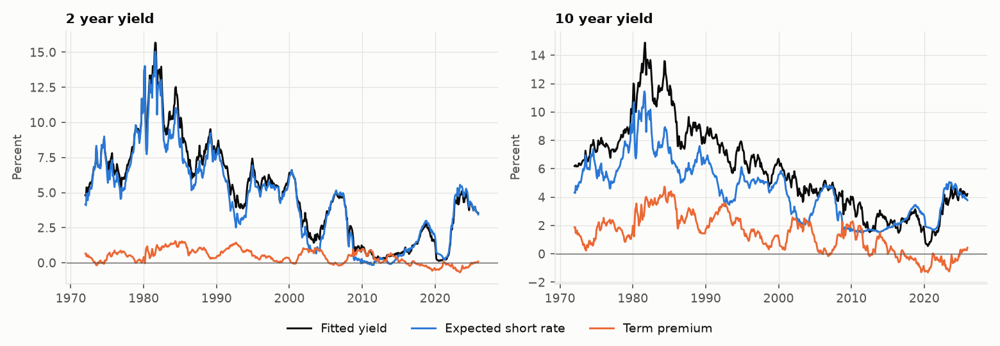
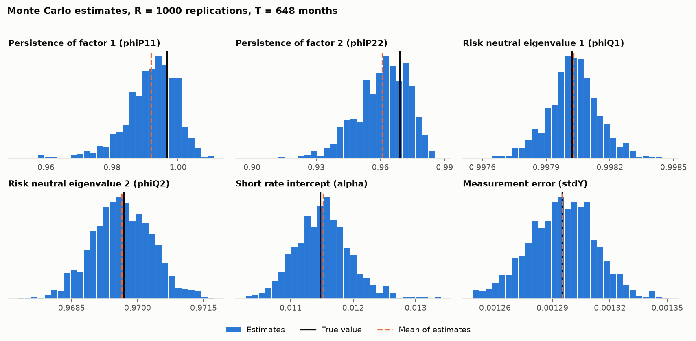

# Two factor Gaussian affine term structure model in Python

A Python version of the estimation and Monte Carlo code from my master's thesis
*Survey Expectations and Finite-Sample Bias in a Macro-Finance Gaussian Affine Term
Structure Model* (Aarhus University, 2026). The original MATLAB code is in
[Project_MScThesis](https://github.com/S0612/Project_MScThesis).

This is a simplified version. It covers the two factor model only: maximum
likelihood estimation with a Kalman filter, a Monte Carlo study of finite sample bias,
and a decomposition of yields into expected short rates and term premia. It does not
include the four factor model, the survey expectations or the CMA-ES optimiser from
the thesis.

## The model

Time is monthly and yields are annualised decimals.

```
short rate     r_t     = 12 (alpha + x1_t + x2_t)
P dynamics     x_t     = mu + Phi x_{t-1} + Sigma eps_t,        eps_t ~ N(0, I)
Q dynamics     diagonal AR matrix diag(phiQ1, phiQ2), phiQ1 >= phiQ2, zero mean
observed       y_t     = g0 + gx x_t + stdY v_t,                v_t ~ N(0, I)
```

`g0` and `gx` follow from the bond pricing recursion. There are 13 free parameters
(`phiQ11, phiQ22, alpha, muP1, muP2, phiP11, phiP12, phiP21, phiP22, sigma11, sigma21,
sigma22, stdY`), the same as in the MATLAB code. Yields at maturities of 1, 2, 5, 7, 10
and 15 years are used.

## Quick start

```
pip install -r requirements.txt

python monte_carlo.py --truth thesis --R 1000                       # thesis parameters as the truth
python monte_carlo.py --params results/params_estimated.json --R 1000   # estimates as the truth
python -m pytest tests
```

To use other data: The format is the one used in the thesis, a CSV
with one row per month and one column per maturity, yields in percent and no header,
plus a second CSV `<name>_maturities.csv` with one row of maturities in years.

```
python estimate.py --yields US_monthly_yields_Jan1972_Dec2025.csv --start 1972-01
```

## Files

| File | Content |
|---|---|
| `gatsm.py` | Model, bond pricing, Kalman filter, simulation, estimation, standard errors, yield decomposition |
| `estimate.py` | Estimates the model on a data set and writes tables and figures |
| `monte_carlo.py` | Simulates, re estimates and measures finite sample bias. Seeded and run in parallel |
| `make_demo_data.py` | Simulates a data set in the real file format |
| `plotting.py` | Figures |
| `tests/test_gatsm.py` | Checks against independent implementations |

## Data used

Data used is from the U.S. Federal Reserve Board (see https://www.federalreserve.gov/pubs/feds/2006/200628/200628abs.html).
Specifically it is the zero-coupon Svensson yields estimated by Gurkaynak, Sack, and Wright (2007). 

## How the estimation works

- The log likelihood comes from a Kalman filter written with numba. After the state
  covariance has converged (about 16 months here) the filter switches to the steady
  state recursion, so one likelihood evaluation takes roughly 0.2 ms.
- The likelihood is maximised using the Nelder-Mead simplex on an unconstrained transformation of the
  parameters, restarted until it stops improving. `estimate.py` starts from two points
  (the thesis starting values and a PCA based start) and reports both, so you can see
  whether they reach the same likelihood.
- Standard errors are outer product of scores (OPG) standard errors.
- The expected short rate for a given maturity is the average of the expected short rates
  under P over that maturity, using the filtered states. The term premium is the fitted
  yield minus that.

## Monte Carlo

Each replication simulates a sample of 648 months (as in the thesis) from the model at the
true parameters, estimates the model again from two starting points (the truth and a PCA
based start) and keeps the better likelihood. Bias is the mean of the estimates minus the
true value. Every replication has its own seed, so the results do not depend on the number
of processes.

The true parameters are either the thesis values in `gatsm.START_VALUES` (`--truth thesis`:
P dynamics with no cross terms and the same persistence as under Q) or the estimates from
`estimate.py` (`--params results/params_estimated.json`). `--summarise mc_estimates.npy`
rebuilds the table and figure from saved estimates without simulating again.

## Differences from the MATLAB code

- Nelder-Mead optimisation instead of CMA-ES. Because everything here is seeded, results can be
  reproduced exactly.
- The risk neutral matrix is exactly diagonal, as in the MATLAB Monte Carlo script. The
  MATLAB estimation script adds a small off diagonal term for nearly equal eigenvalues.
- The Kalman filter uses the steady state shortcut described above. It changes the
  likelihood by a negligible amount.
- Stationarity under P is imposed in both estimation and simulation.
- All yields are in annualised decimals, including the measurement error `stdY`. The MATLAB
  Monte Carlo script works in monthly units.

## Checks

`tests/test_gatsm.py` compares the closed form bond loadings with the recursion used in the
MATLAB code, compares the filter likelihood with a plain textbook Kalman filter, checks the
simulated moments against the model's unconditional moments, and checks that the likelihood
falls when the true parameters are perturbed.

## Limitations

- Starting each Monte Carlo replication at the true parameters is a computational shortcut.
  It measures bias around the true optimum, not how often an optimiser finds it.
- The Monte Carlo truth is the estimated model, so the bias table describes finite sample bias
  if that model were the true data generating process.
- OPG standard errors can be unreliable when the data are close to a unit root, as the
  factors are here.
- The decomposition uses filtered states, not smoothed states.
- Results depend on the data and on the model restrictions (two factors, diagonal risk
  neutral matrix, equal loadings on the short rate).

## Results

All output is in `results/`. The data are US monthly yields, January 1972 to December 2025
(648 months), at maturities of 1, 2, 5, 7, 10 and 15 years.

### Check against the thesis

The estimates reproduce the CMA-ES estimates in the thesis using MATLAB. The log likelihood at the Python
estimates is 18566.99 and at the thesis CMA-ES estimates (rounded to six decimals) it is
18566.97. Starting from the thesis values and from the PCA start gives the same likelihood.

| Parameter | Python, Nelder-Mead Optimiser | Thesis (MATLAB), CMA-ES Optimiser|
|---|---|---|
| phiQ11 | 0.998022 | 0.998022 |
| phiQ22 | 0.969682 | 0.969681 |
| alpha | 0.011477 | 0.011471 |
| muP1 | -0.000011 | -0.000011 |
| muP2 | -0.000067 | -0.000067 |
| phiP11 | 0.996663 | 0.996704 |
| phiP12 | 0.018478 | 0.018586 |
| phiP21 | -0.006611 | -0.006655 |
| phiP22 | 0.969088 | 0.969117 |
| sigma11 | 0.000317 | 0.000317 |
| sigma21 | -0.000179 | -0.000179 |
| sigma22 | 0.000386 | 0.000386 |
| stdY | 0.001295 | 0.001295 |

The standard errors are of the same size as in the thesis, with small differences in the last
printed digits. Root mean squared pricing errors are between 6 and 14 basis points.



The average 10 year term premium is 1.37 percentage points. It is high in the early 1980s
and negative around 2020.

### Finite sample bias

1000 replications of 648 months, with the estimates on the real data as the true parameters.
On a 6 core Ryzen 5 3600 this takes about 22 minutes.

| Parameter | True | Mean of estimates | Bias | Bias (%) |
|---|---|---|---|---|
| phiP11 | 0.99666 | 0.99176 | -0.00490 | -0.5 |
| phiP22 | 0.96909 | 0.96088 | -0.00821 | -0.8 |
| phiQ11 | 0.99802 | 0.99803 | 0.00001 | 0.0 |
| phiQ22 | 0.96968 | 0.96964 | -0.00004 | 0.0 |
| alpha | 0.01148 | 0.01152 | 0.00004 | 0.4 |
| stdY | 0.001295 | 0.001295 | 0.000000 | 0.0 |

The persistence of the factors under P is biased downward, by 0.005 for the first factor and
0.008 for the second. That is about two thirds of the standard deviation of the estimates.
The risk neutral parameters, the short rate intercept and the measurement error are close to
unbiased. The full table is in `results/mc_bias_table.csv`.



### References
- Gürkaynak, Refet S., Brian Sack, and Jonathan H. Wright. "The US Treasury yield curve: 1961 to the present." Journal of monetary Economics 54.8 (2007): 2291-2304.
